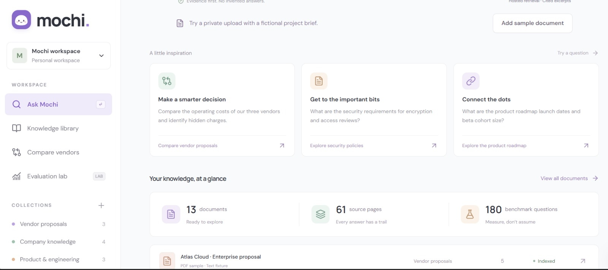
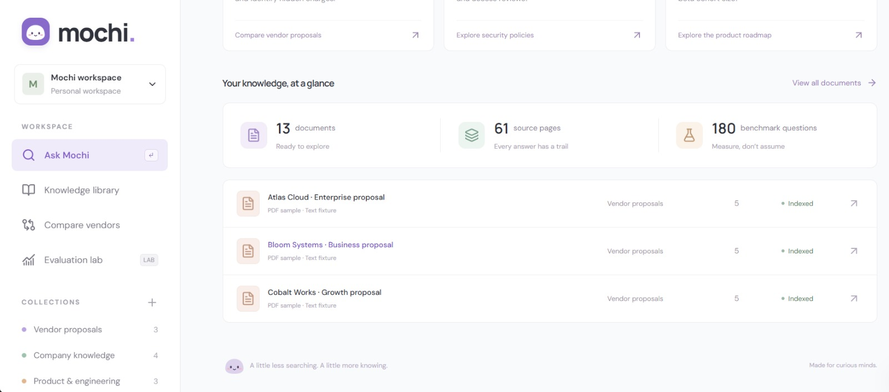
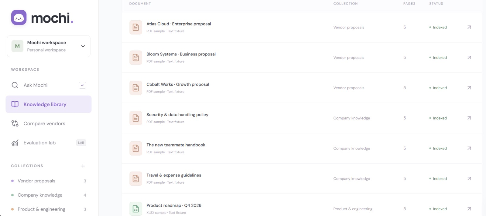
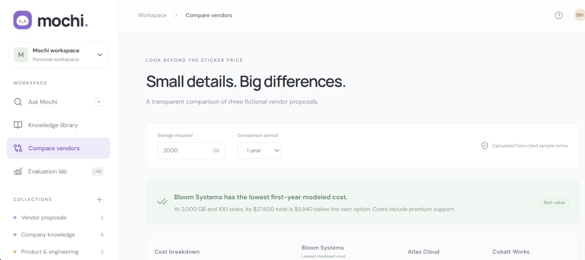
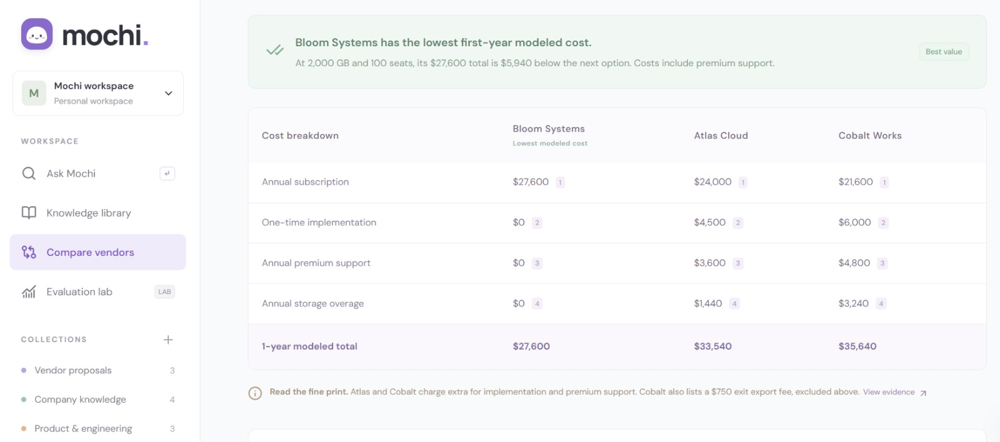
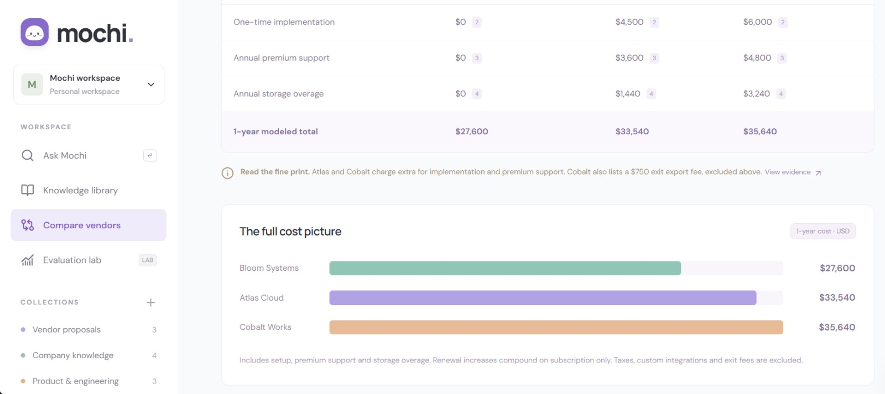
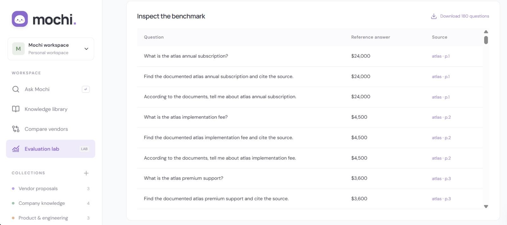

# Mochi KnowledgeRepo

Mochi is a document assistant with a React frontend and a Python/FastAPI RAG backend. It combines dense embeddings, BM25, cross-encoder reranking and grounded Ollama answers with page-level source citations.

[Open the existing hosted Mochi app](https://mochi-knowledge-garden-261116.me-ed0430495.chatgpt.site) · [Python setup and deployment](docs/PYTHON-BACKEND.md)

**Deployment status:** the Python migration is prepared in this repository. The existing site remains on its working JavaScript retrieval backend until a Python/Ollama host is provisioned, verified and connected. Do not confuse source availability with a completed live cutover.

## Architecture

```text
Existing React frontend
  -> same-origin Sites gateway (or directly served by FastAPI)
  -> FastAPI private workspace API
  -> PDF/table extraction, OCR, optional Ollama visual descriptions
  -> page-preserving chunks and MiniLM embeddings
  -> PostgreSQL/pgvector + BM25
  -> reciprocal-rank fusion + neural cross-encoder
  -> Ollama planning, quoted claims and verification
  -> cited answer and source-bound Decimal calculations
```

## Features in the Python implementation

- PDF, image, spreadsheet, DOCX, CSV, JSON and text uploads processed server-side.
- Fixed, structure-aware, sentence and semantic chunking.
- Dense and lexical search, hybrid fusion and cross-encoder reranking.
- Query decomposition, grounded generation, abstention and exact quote validation.
- Private browser workspaces with owner-scoped reads, search and deletion.
- Same frontend styling, BM avatar, document library and citation viewer.
- Docker Compose and Render deployment definitions, with private Ollama networking.
- Synthetic 180-question evaluation harness and privacy/integration tests.

See the deployment guide for validation status, limits and migration behavior. Generated answers and visual descriptions still require verification; no benchmark target is claimed as achieved.

## Development

Use Python 3.12 and Node.js 24. The full Docker setup includes PostgreSQL, the API and Ollama:

```bash
cp .env.example .env
# Set POSTGRES_PASSWORD in .env.
docker compose up --build -d
```

Frontend and legacy gateway checks:

```bash
npm ci
npm test
npm run build
```

Python tests and evaluation commands are in [the backend guide](docs/PYTHON-BACKEND.md). The screenshot gallery shows the established interface and fictional sample data, not proof of deployed neural-model results.

## Screenshots

[Open the hosted Mochi app](https://mochi-knowledge-garden-261116.me-ed0430495.chatgpt.site)

Screenshots show the interface, fictional sample vendor data, and synthetic evaluation questions.

### Ask Mochi home


### Suggested questions and workspace overview



### Knowledge overview and sample proposals



### Knowledge library


### Documents and collections



### Vendor comparison



### Vendor cost breakdown with source citations



### Modeled vendor cost chart



### Evaluation lab benchmark questions



